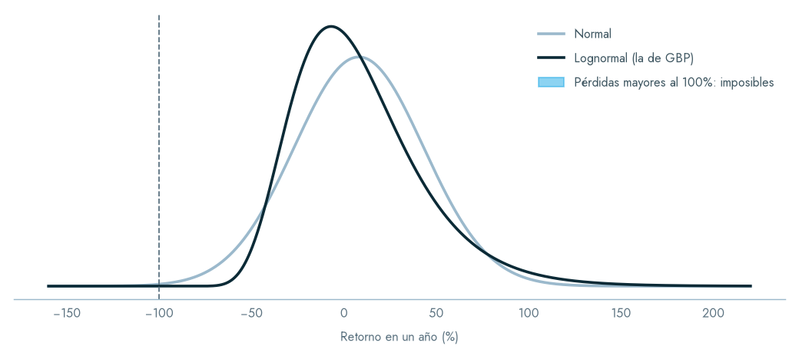
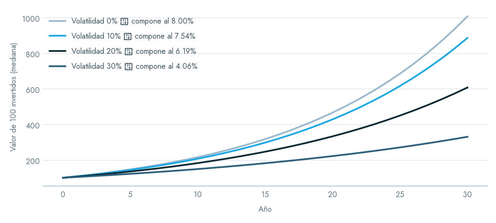
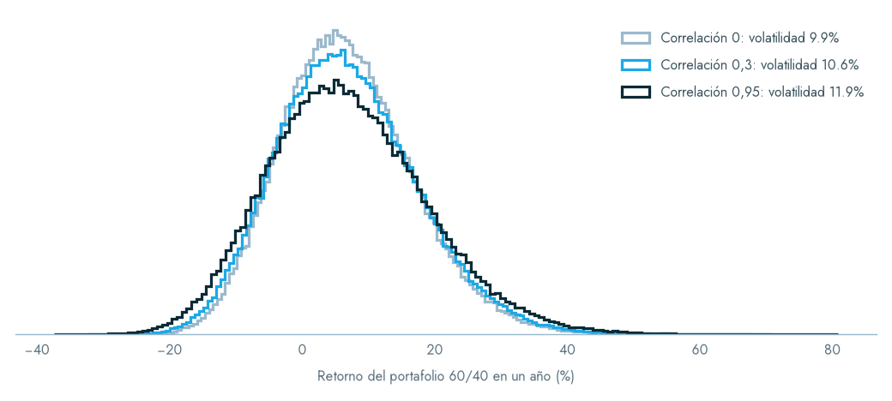
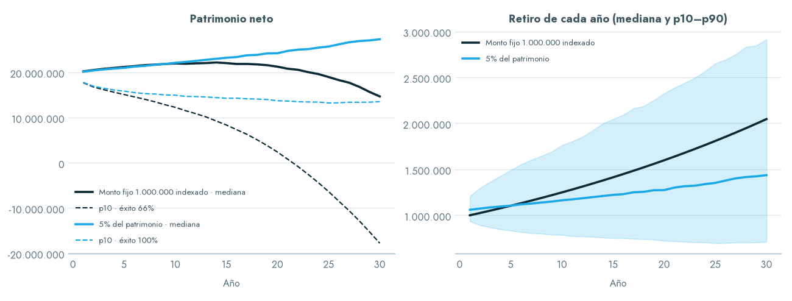
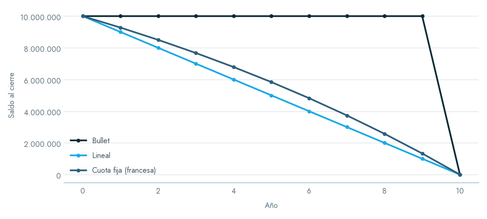
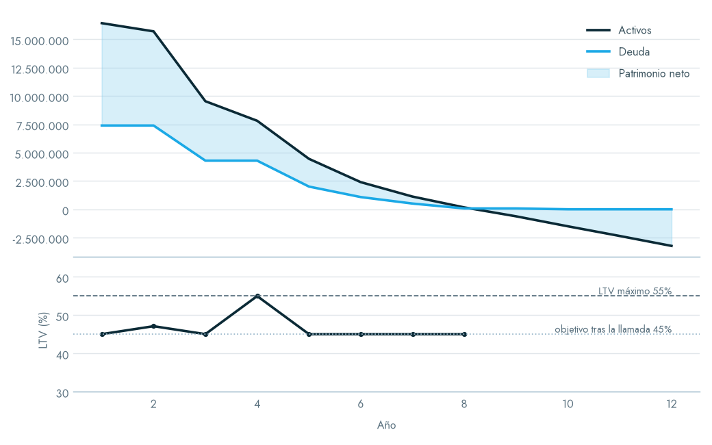
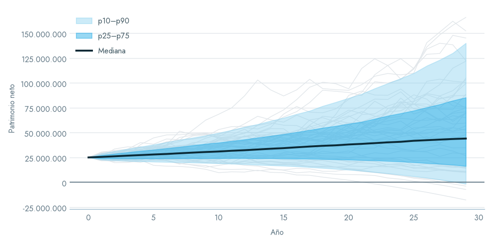
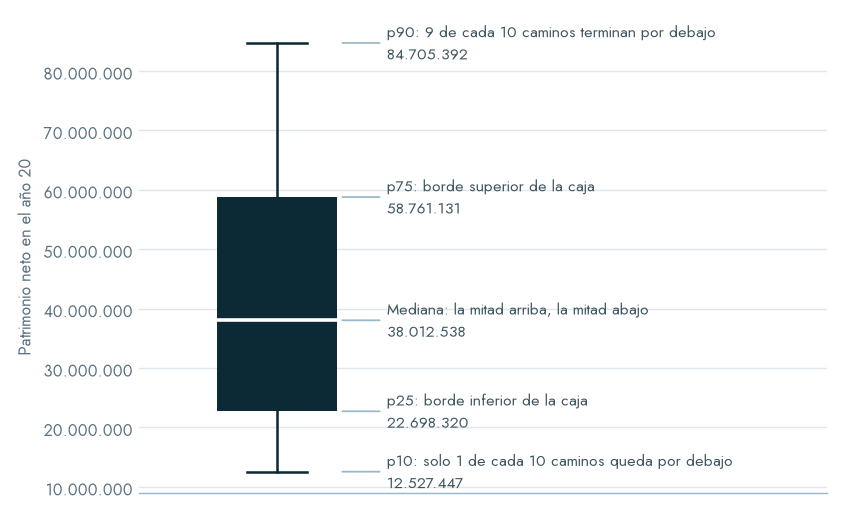
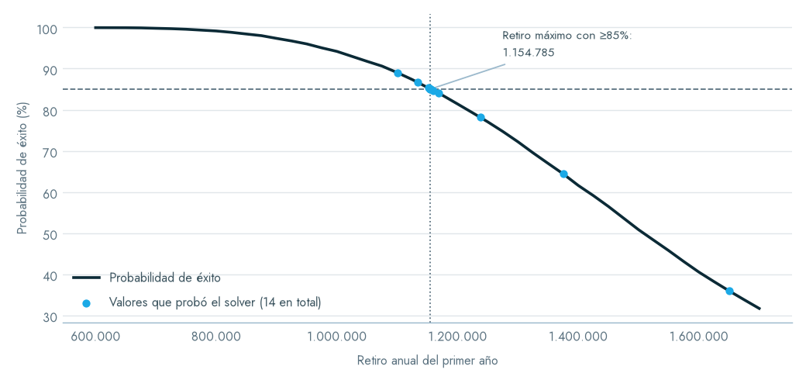

# El modelo de proyección de GBP

Cómo proyecta GBP el patrimonio de un cliente: toda la matemática, ejemplos resueltos a mano y lo que pasa por dentro de la app, desde que se pulsa «Correr simulación» hasta que sale el PDF.

El documento tiene dos partes:

- **Parte I, el modelo.** Qué se calcula y por qué. Se puede leer sin abrir el código.
- **Parte II, la construcción.** Cómo está hecha la app: módulos, hilos, archivos, rendimiento y empaquetado.

Cuando hace falta señalar dónde vive una regla, se cita el archivo. Las fórmulas están en LaTeX; el preview de Markdown de VS Code y GitHub las renderizan.

Las figuras de `docs/img/` las genera [tools/make_modelo_figures.py](tools/make_modelo_figures.py) con el motor real de la app, no con ilustraciones aparte. Ese script también imprime las cifras de los ejemplos resueltos, para poder contrastarlas. Si el modelo cambia, se vuelve a correr y el documento muestra lo que la app hace.

---

## Índice

**Parte I — El modelo**

0. [Notación](#0-notación)
1. [La pregunta que responde](#1-la-pregunta-que-responde)
2. [Los supuestos de mercado](#2-los-supuestos-de-mercado)
3. [Por qué lognormal, y la conversión de los supuestos](#3-por-qué-lognormal-y-la-conversión-de-los-supuestos)
4. [El sorteo correlacionado](#4-el-sorteo-correlacionado)
5. [Del activo al portafolio: rebalanceo anual](#5-del-activo-al-portafolio-rebalanceo-anual)
6. [Flujos](#6-flujos)
7. [El año, paso a paso](#7-el-año-paso-a-paso)
8. [Crédito y llamadas a margen](#8-crédito-y-llamadas-a-margen)
9. [De los caminos a los números](#9-de-los-caminos-a-los-números)
10. [Los supuestos resumen](#10-los-supuestos-resumen)
11. [Metas](#11-metas)
12. [Solver](#12-solver)
13. [Pesos colombianos](#13-pesos-colombianos)
14. [Activos fuera del LTCMA](#14-activos-fuera-del-ltcma)
15. [Qué no hace el modelo](#15-qué-no-hace-el-modelo)
16. [Validación contra la fuente](#16-validación-contra-la-fuente)

**Parte II — Cómo está construida la app**

17. [Mapa de módulos](#17-mapa-de-módulos)
18. [Recorrido de un clic](#18-recorrido-de-un-clic)
19. [Hilos](#19-hilos)
20. [Qué se guarda y dónde](#20-qué-se-guarda-y-dónde)
21. [Rendimiento](#21-rendimiento)
22. [Empaquetado](#22-empaquetado)
23. [Pruebas y herramientas](#23-pruebas-y-herramientas)

[Resumen en una página](#resumen-en-una-página)

---

# Parte I — El modelo

## 0. Notación

| Símbolo | Qué es |
|---|---|
| $N$ | número de caminos simulados (10.000 por defecto) |
| $T$ | horizonte en años; los años van de $t = 1$ a $T$ |
| $K$ | número de clases de activo en la corrida |
| $i$ | una clase de activo; $n$ un camino |
| $c_i$ | retorno **compuesto** esperado de la clase $i$ (lo que publica el LTCMA) |
| $s_i$ | volatilidad **aritmética** anual de la clase $i$ (lo que publica el LTCMA) |
| $\mu_i,\ \sigma_i$ | media y desviación del **logaritmo** del retorno bruto |
| $\rho_{ij}$ | correlación entre las clases $i$ y $j$ |
| $w_i$ | peso objetivo de la clase $i$ en la estrategia, $\sum_i w_i = 1$ |
| $G_{n,t}$ | factor de crecimiento del portafolio (1 + retorno) en el camino $n$, año $t$ |
| $A_{n,t},\ D_{n,t}$ | activos y deuda al cierre del año $t$ |
| $W_{n,t} = A_{n,t} - D_{n,t}$ | **patrimonio neto**, lo que miden todos los indicadores |
| $\pi$ | inflación anual del escenario |
| $r^{c}_{n,t}$ | tasa de caja del año (simulada, o la esperada si la caja no entra al sorteo) |

---

## 1. La pregunta que responde

> Dado un capital inicial, una mezcla de activos, unos aportes y retiros y, eventualmente, un crédito: **¿cómo se distribuye el patrimonio del cliente a lo largo del horizonte, y con qué probabilidad el plan se sostiene?**

**No es un pronóstico.** El resultado no es «el patrimonio será X en el año 20». Es una **distribución** de miles de trayectorias posibles, todas coherentes con los mismos supuestos de mercado de largo plazo. El modelo replica la metodología *Goals-Based Planning* de J.P. Morgan y usa como caso de control la lámina 9 de su documento de referencia (§16).

**La unidad de comparación es la estrategia**, y una estrategia es un *plan completo*: su mezcla de activos, sus aportes y retiros, su crédito y, si se quiere, su propio capital inicial. Así se comparan planes de verdad distintos, por ejemplo uno apalancado contra uno sin deuda, y no solo dos mezclas de activos.

Lo común a toda la corrida es el **escenario**: el capital inicial, el horizonte y la inflación, más dos opciones que no entran a la simulación, las **metas** (§11) y la **tasa USD/COP** (§13).

---

## 2. Los supuestos de mercado

Cada clase de activo se describe con tres números, más la matriz de correlación entre todas:

| Supuesto | Qué es |
|---|---|
| **Retorno compuesto** $c_i$ | El retorno geométrico esperado de largo plazo |
| **Volatilidad** $s_i$ | La desviación estándar anual del retorno |
| **Yield** | La parte del retorno que llega como flujo y no como apreciación |

**Vienen del LTCMA 2026 de J.P. Morgan**: la tabla en USD, con 59 clases de activo y su matriz de correlación completa. Viajan embebidos en la app, en `gbp/data/`.

**No se editan desde la interfaz.** Se ven en modo lectura y se actualizan reimportando el documento con `tools/import_ltcma.py`. La razón es de gobierno, no técnica: son supuestos institucionales, y si cada usuario los edita, dos personas con el mismo caso obtienen proyecciones distintas sin que nada lo deje ver. La excepción son los activos propios (§14).

> **El yield es informativo.** El LTCMA no lo publica por clase, así que la librería lo siembra en 0. Aparece como 0,00% en los supuestos resumen y **no afecta la proyección**, porque el motor usa el retorno total.

---

## 3. Por qué lognormal, y la conversión de los supuestos

El motor no trabaja con el retorno sino con el **logaritmo del retorno bruto**:

$$
\ln(1 + R_{i}) \sim \mathcal{N}(\mu_i,\ \sigma_i^2)
\qquad\Longrightarrow\qquad
1 + R_i = e^{\mu_i + \sigma_i Z},\quad Z \sim \mathcal{N}(0,1)
$$

Hay dos razones, y las dos importan:

1. **Ningún activo puede perder más del 100% en un año.** $e^{x} > 0$ siempre. Con retornos normales, un activo con 8% esperado y 35% de volatilidad tendría probabilidad no nula de caer 150%, y aparecerían patrimonios negativos por pura aritmética.
2. **Reproduce el arrastre de la volatilidad.** Dos activos con el mismo retorno *aritmético* y distinta volatilidad no componen igual: el más volátil compone a menos.



*Mismo retorno esperado (8%) y volatilidad (35%). La normal asigna probabilidad a perder más del 100% (zona sombreada); la lognormal no puede.*



*Mismo retorno aritmético (8%), distinta volatilidad. La mediana de 100 invertidos a 30 años cambia mucho: es el arrastre de la volatilidad.*

### La conversión

J.P. Morgan publica el retorno **compuesto** $c_i$ y la volatilidad **aritmética** $s_i$. El retorno compuesto es la mediana del retorno bruto de una lognormal, así que:

$$
\mu_i = \ln(1 + c_i)
$$

La volatilidad pide más cuidado. Para una lognormal, la volatilidad aritmética se relaciona con la **media aritmética** $m_i = \mathbb{E}[1+R_i]$, no con el retorno compuesto:

$$
s_i^2 = m_i^2\left(e^{\sigma_i^2} - 1\right)
\qquad\text{con}\qquad
m_i = (1 + c_i)\, e^{\sigma_i^2/2}
$$

Como $m_i$ depende de $\sigma_i$, no hay forma cerrada. Se resuelve por **punto fijo** en [assets.py](gbp/model/assets.py) (`AssetClass.sigma_log`), empezando por $\sigma^2_{(0)} = \ln\left(1 + (s/(1+c))^2\right)$:

$$
\sigma^2_{(k+1)} = \ln\left(1 + \left(\frac{s_i}{(1+c_i)\,e^{\sigma^2_{(k)}/2}}\right)^2\right)
$$

Converge en pocas iteraciones, con tolerancia $10^{-15}$. El retorno aritmético implícito es:

$$
a_i = e^{\mu_i + \sigma_i^2/2} - 1
$$

**Ejemplo con un activo real, U.S. Large Cap** (lo imprime el script de figuras):

| | Valor |
|---|---|
| Retorno compuesto publicado $c$ | 6,7000% |
| Volatilidad publicada $s$ | 16,4700% |
| $\mu = \ln(1{,}067)$ | 0,064851 |
| $\sigma$ (punto fijo) | 0,151715 |
| Retorno aritmético implícito $a$ | 7,9351% |

Comprobación: $1{,}067 \cdot e^{0{,}151715^2/2} = 1{,}079351$, o sea 7,9351%. La brecha de 1,24 puntos entre 7,94% y 6,70% es exactamente el arrastre de la volatilidad.

> **Por qué importa que la conversión sea reversible.** Con la conversión correcta, pasar de $c$ a $a$ y volver da el $c$ original. Eso es lo que permite contrastar los supuestos resumen con los publicados. Una versión temprana normalizaba por el retorno compuesto en vez de por la media aritmética, y la ida y vuelta no cerraba. Era un error silencioso que solo se vio al comparar contra la fuente.

---

## 4. El sorteo correlacionado

### La covarianza en espacio logarítmico

$$
\Sigma_{ij} = \sigma_i\, \sigma_j\, \rho_{ij}
$$

### Reparación de la matriz publicada

La matriz del LTCMA viene redondeada a dos decimales y estimada sobre ventanas distintas, así que **no es exactamente semidefinida positiva (PSD)**: su menor autovalor es del orden de −0,016. Una matriz así describe un mundo imposible, donde alguna combinación de activos tendría varianza negativa, y no admite Cholesky.

Al cargarla se proyecta a la PSD más cercana ([correlation.py](gbp/model/correlation.py), `nearest_psd`). El procedimiento:

1. Descomposición espectral $\rho = Q \Lambda Q^\top$.
2. Autovalores truncados a $\max(\lambda_k, 10^{-10})$.
3. Recomposición $\tilde\rho = Q\tilde\Lambda Q^\top$.
4. Renormalización de la diagonal a 1: $\hat\rho_{ij} = \tilde\rho_{ij} / \sqrt{\tilde\rho_{ii}\tilde\rho_{jj}}$.

El JSON conserva los valores tal como los publica J.P. Morgan, y se guarda cuánto hubo que corregir: el ajuste máximo es **0,008**, cosmético pero auditable. La app lo informa en la pestaña Correlaciones.

### El factor de Cholesky y el sorteo

Con $\Sigma = L L^\top$ (Cholesky, triangular inferior), para cada camino $n$ y año $t$:

$$
\mathbf{z}_{n,t} \sim \mathcal{N}(\mathbf{0}, I_K)
\qquad
\ln \mathbf{g}_{n,t} = \boldsymbol{\mu} + L\,\mathbf{z}_{n,t}
\qquad
\mathbf{g}_{n,t} = e^{\ln \mathbf{g}_{n,t}}
$$

donde $\mathbf{g}_{n,t}$ es el vector de retornos brutos $1 + R_i$. Como $\operatorname{Cov}(L\mathbf{z}) = LL^\top = \Sigma$, los shocks independientes salen con exactamente las correlaciones pedidas.

En código, para todos los caminos y años a la vez ([montecarlo.py](gbp/engine/montecarlo.py), `_simulate_asset_returns`):

```python
shocks  = rng.standard_normal((N, T, K))   # z
returns = shocks @ L.T                     # L z, para todos los (n, t) a la vez
returns += mu                              # + μ
np.exp(returns, out=returns)               # retorno bruto
```

Dos casos que el factor tolera, en `cholesky_factor`:

- **Clases sin volatilidad.** Quedan fuera del factor y su fila en cero: no reciben shock, en vez de un ruido numérico espurio.
- **Matriz no definida positiva por redondeo.** Se repara con `nearest_psd` y un empujón de $10^{-12}\cdot\operatorname{tr}$ en la diagonal.

### Números aleatorios comunes

El sorteo se hace **una sola vez por corrida**, sobre la unión de las clases de todas las estrategias, con semilla fija (42). **Todas las estrategias leen el mismo bloque** $N \times T \times K$. Si cada una sorteara su propio azar, una podría verse mejor solo por suerte en su muestra. Con los mismos sorteos, la diferencia entre dos estrategias **es la estrategia**. El solver (§12) depende de esta misma propiedad.

**La caja siempre entra al sorteo**, aunque ninguna estrategia la use. De ella dependen la tasa de un crédito a spread y el devengo de un patrimonio agotado.

### Por qué importa la correlación



*El mismo 60/40 con tres correlaciones entre acciones y bonos. La volatilidad del portafolio pasa de 9,9% a 11,9% y la cola izquierda se ensancha.*

El portafolio se agrega **después** del sorteo (§5), así que **el motor nunca recibe la volatilidad del portafolio como dato: la produce**, a partir de las volatilidades individuales y la matriz. Con activos independientes, la volatilidad del portafolio saldría subestimada y, con ella, los percentiles bajos, el CVaR y la probabilidad de éxito. Son precisamente los números sobre los que se decide el plan. Con crédito el efecto se amplifica: una llamada a margen ocurre cuando el portafolio **entero** cae a la vez, que es justo lo que codifica la correlación.

---

## 5. Del activo al portafolio: rebalanceo anual

$$
G_{n,t} = \sum_{i=1}^{K} w_i\, g_{n,t,i}
$$

Ponderar cada año con los pesos **objetivo** equivale a **rebalancear al cierre de cada año**. El modelo no deja derivar la composición con el tiempo. Los pesos se normalizan sobre lo cargado: si suman 99,8%, se reparten sobre 99,8%.

---

## 6. Flujos

Un flujo es un aporte o un retiro recurrente entre un año inicial y uno final, ambos inclusive. Se expresa de una de dos formas ([cashflows.py](gbp/model/cashflows.py)).

### Monto fijo

El monto ingresado, $F$, es **el que se paga el año 1**, y se indexa desde el año 2:

$$
F_t = F \cdot (1+g)^{\,t-1}
\qquad\text{con}\qquad
1 + g = (1 + \pi\cdot\mathbb{1}_{\text{indexado}})\,(1 + g_{\text{real}})
$$

Un retiro de 1.000 con inflación de 5% vale 1.000 el año 1, 1.050 el año 2 y 1.102,50 el año 3. Un flujo que empieza más tarde también se expresa en moneda del año 1, así que el del año 5 ya llega con cuatro años de indexación.

> **Esto se aparta de J.P. Morgan a propósito.** J.P. Morgan indexa desde el año 1, con factor $(1+\pi)^t$, y con esa convención el total de retiros del ejemplo de referencia coincidía con sus 47,2 millones. Ikalon decidió que el monto que se ingresa es el del primer año tal cual. Con eso el mismo ejemplo da 46.041.925: un año menos de inflación.

Los montos fijos se conocen antes de simular, así que el motor los precalcula en dos vectores de longitud $T$: aportes $I_t$ y retiros $O_t$.

### Porcentaje del patrimonio

Una fracción $p$ del **patrimonio neto** del año, al estilo de la regla del 4% de un endowment. No se puede precalcular: depende de cada camino. La base se fija **antes** de aplicar cualquier retiro del año, así que varios flujos porcentuales no dependen del orden en que se listen:

$$
B_{n,t} = \max(A'_{n,t} - D'_{n,t},\ 0)
\qquad
\text{flujo}_{n,t} = \pm\, p \cdot B_{n,t}
$$

$A'$ y $D'$ son los activos y la deuda ya crecidos y servidos ese año (§7). La base es **neta** porque con apalancamiento el activo bruto no es del cliente: retirar 4% de 10 millones de activos con 5 millones de deuda sería retirar el 8% de lo que realmente tiene. Un patrimonio negativo no genera retiro, porque no se saca un porcentaje de una deuda. Un flujo porcentual ignora la indexación: el patrimonio ya creció.



*El mismo portafolio con dos reglas de gasto. El retiro fijo mantiene estable lo que recibe el cliente y traslada el riesgo al patrimonio, que se puede agotar (66% de éxito). El porcentual se autorregula: nunca agota el portafolio (100%), pero el gasto se vuelve volátil (banda de la derecha).*

---

## 7. El año, paso a paso

Para cada camino y cada año, en este orden ([montecarlo.py](gbp/engine/montecarlo.py), `simulate_strategy`):

| # | Paso | Ecuación |
|---|---|---|
| 1 | Desembolso del crédito, si es su año | $A \leftarrow A + P\cdot\mathbb{1}_{t = t_0}$ ; $D \leftarrow D + P\cdot\mathbb{1}_{t=t_0}$ |
| 2 | Aportes de monto fijo | $A \leftarrow A + I_t$ |
| 3 | Retorno de mercado | $A \leftarrow A \cdot G_{n,t}$ si $A>0$; si no, $A \leftarrow A\,(1 + r^{c}_{n,t})$ |
| 4 | Intereses y amortización | $A \leftarrow A - \text{salida del crédito}$ (§8) |
| 5a | Flujos porcentuales | $A \leftarrow A + (p^{+}_t - p^{-}_t)\cdot B_{n,t}$ |
| 5b | Retiros de monto fijo | $A \leftarrow A - O_t$ |
| 6 | Control de LTV | $A \leftarrow A - d$ ; $D \leftarrow D - d$ (§8) |

Se parte de $A_{n,0}$ = capital inicial de la estrategia (el suyo o el del escenario) y $D_{n,0} = 0$. Al cierre se registran $A_{n,t}$, $D_{n,t}$ y $W_{n,t} = A_{n,t} - D_{n,t}$.

**El orden no es cosmético.** Los retiros van después del retorno, así que se gasta sobre el patrimonio ya crecido; al revés daría otro número. La llamada a margen va al final, así que se evalúa contra el patrimonio después de todos los movimientos del año.

**Un patrimonio agotado es un descubierto, no una posición invertida.** Si los retiros consumen el portafolio, el saldo queda negativo y desde ahí devenga a la **tasa de caja** y no al retorno del portafolio (paso 3). Sin esa regla, una deuda de 50 millones «capitalizaría» al 7% anual como si estuviera invertida, y haría ver mejor de lo que son los caminos que ya fracasaron.

### Ejemplo resuelto: tres años de un camino

Un solo camino con retornos fijados a mano, para seguir cada paso. El script de figuras corre este mismo camino con el motor real y da las mismas cifras.

- Capital inicial 10.000.000. Inflación 3%. Caja 3%.
- Aporte de 500.000 solo el año 1.
- Retiro de 400.000 al año, indexado.
- Crédito de 4.000.000 el año 1 a tasa fija de 6%, intereses pagados, bullet a 5 años, LTV máximo 35% y objetivo 30%.
- Retornos del portafolio: **+10%, −30% y +15%**.

| Paso | Año 1 | Año 2 | Año 3 |
|---|---:|---:|---:|
| Activos al inicio | 10.000.000 | 15.310.000 | 8.664.286 |
| 1 · Desembolso | +4.000.000 | — | — |
| 2 · Aporte | +500.000 | — | — |
| = antes del mercado | 14.500.000 | 15.310.000 | 8.664.286 |
| 3 · Retorno | ×1,10 → 15.950.000 | ×0,70 → 10.717.000 | ×1,15 → 9.963.929 |
| 4 · Intereses (6% de la deuda) | −240.000 | −240.000 | −155.957 |
| 5 · Retiro indexado | −400.000 | −412.000 | −424.360 |
| = antes del control de LTV | 15.310.000 | 10.065.000 | 9.383.611 |
| LTV = D / A | 4,0 / 15,31 = 26,1% | 4,0 / 10,065 = **39,7% > 35%** | 2,60 / 9,38 = 27,7% |
| 6 · Venta forzada $d$ | — | **1.400.714** | — |
| **Activos al cierre** | **15.310.000** | **8.664.286** | **9.383.611** |
| **Deuda al cierre** | 4.000.000 | 2.599.286 | 2.599.286 |
| **Patrimonio neto** | **11.310.000** | **6.065.000** | **6.784.326** |

La venta del año 2 sale de la fórmula del §8:

$$
d = \frac{D - t\,A}{1-t} = \frac{4.000.000 - 0{,}30 \times 10.065.000}{0{,}70} = 1.400.714
$$

Deja la deuda en 2.599.286 y los activos en 8.664.286, es decir, un LTV de 30%. **El patrimonio neto del año 2 no cambia con la venta** (6.065.000 antes y después): vender activos para pagar deuda baja los dos lados por igual.

---

## 8. Crédito y llamadas a margen

El crédito se simula camino por camino ([leverage.py](gbp/model/leverage.py)), porque la tasa, si es a spread, y las llamadas a margen dependen de cada camino.

| Parámetro | Opciones |
|---|---|
| Tasa | Fija $r$, o spread $s$ sobre la caja: $r_{n,t} = r^{c}_{n,t} + s$ |
| Intereses | Pagados (salen del portafolio) o capitalizados (se suman al saldo) |
| Amortización | Bullet, lineal o cuota fija (francesa) |
| LTV | Máximo $L_{\max}$, y objetivo $L^{*} \le L_{\max}$ tras la llamada |

### El cronograma

Se expresa como fracciones $f_k$ del **principal original** $P$, para $k = 0,\dots,M-1$ años desde el desembolso. Se calcula **una sola vez**, con una tasa de referencia determinística $\bar r$ (la fija, o la caja esperada más el spread). Así la cuota es estable aunque la tasa realizada varíe entre caminos, que es como funciona un crédito en la práctica.

- **Bullet:** $f_k = 0$ salvo $f_{M-1} = 1$.
- **Lineal:** $f_k = 1/M$.
- **Cuota fija:** con $q = \bar r / (1 - (1+\bar r)^{-M})$ y saldo unitario $b_0 = 1$, la parte de principal es $f_k = q - \bar r\, b_k$ y $b_{k+1} = b_k - f_k$.

Cada año del plazo:

$$
\text{interés} = D\cdot r_{n,t}
\qquad
\text{principal} =
\begin{cases}
D & \text{si es el último año del plazo}\\[2pt]
\min(D,\ P f_k) & \text{si no}
\end{cases}
$$

Con intereses pagados, la salida del portafolio es interés + principal. Con intereses capitalizados, el interés se suma a $D$ y solo sale el principal. En el vencimiento se cancela **todo** el saldo, incluidos los intereses capitalizados que quedaron por encima de $P$.



*Saldo de un crédito de 10.000.000 a 10 años y 7%, con las tres amortizaciones.*

### La llamada a margen

Si $D > 0$ y $D / A > L_{\max}$, se venden activos hasta volver a $L^*$. Vender $d$ baja los dos lados:

$$
\frac{D - d}{A - d} = L^{*}
\quad\Longrightarrow\quad
d = \frac{D - L^{*} A}{1 - L^{*}},
\qquad
d \leftarrow \min\big(\max(d, 0),\ A,\ D\big)
$$

Nunca se vende más de lo que hay ni más de lo que se debe. **Se cuenta una llamada solo si hubo venta** ($d > 0$). Un camino con los activos agotados tiene LTV infinito y «rompe» el límite cada año, pero no tiene nada que vender, y contarlo inflaba las llamadas promedio.



*Un camino real de una estrategia apalancada: cuando el LTV toca el 55% se vende hasta el 45%. Deuda y activos bajan juntos; el patrimonio neto (la franja) no salta.*

> **Un bug que se corrigió.** Como la venta baja activos y deuda por igual, el patrimonio neto no cambia en ese instante. Una versión temprana descontaba la deuda pero no los activos: el patrimonio neto *subía* al recibir una llamada a margen, lo cual es imposible, y los años siguientes capitalizaban sobre un portafolio que ya se había vendido.

---

## 9. De los caminos a los números

**Nada se supone sobre la forma de la distribución**: todos los indicadores salen de contar los caminos simulados ([results.py](gbp/model/results.py)).

### Percentiles, media y desviación

Para un año $t$, $q_p(t)$ es el percentil $p$ de $\{W_{n,t}\}_{n=1}^N$, con interpolación lineal (`np.percentile`). La app muestra $p \in \{10, 25, 50, 75, 90\}$, más la media $\bar W_t = \frac1N\sum_n W_{n,t}$ y la desviación estándar poblacional.



*El caso de ejemplo: 40 caminos individuales (gris) y, encima, las bandas de percentiles que resumen los 10.000.*



*Cómo se lee cada caja del gráfico de distribución, con las cifras reales del año 20 del caso de ejemplo.*

**Por qué percentiles y no bandas de desviación estándar.** El patrimonio simulado es lognormal y **asimétrico a la derecha**. Una banda simétrica alrededor de la media se va demasiado abajo (llega a dar negativa cuando casi ningún camino lo es) y se queda corta en la cola alta. En la figura, la mediana (38 millones) está muy por debajo de la mitad entre p10 y p90.

### Probabilidad de éxito

$$
\Pr(\text{éxito}) = \frac{1}{N}\sum_{n=1}^N \mathbb{1}\left[\ W_{n,t} > 0\ \ \forall\, t = 1,\dots,T\ \right]
$$

Es la fracción de caminos en que el patrimonio neto **nunca** llega a cero. Es más estricta de lo que parece: un camino que se agota en el año 12 y se recupera contablemente después **sigue contando como fallo**, porque quedarse sin patrimonio a mitad de camino no se deshace.

Tres cosas a tener en cuenta al leerla:

- **Un camino que termina con 1 dólar cuenta igual que uno que termina con 50 millones.** Por eso existen la mediana, el CVaR y las metas.
- **Con solo retiros porcentuales sale cerca del 100%**, porque el retiro baja con el portafolio. Es informativa sobre todo con retiros de monto fijo.
- **Con crédito cuenta el patrimonio neto**: si la deuda supera a los activos, el camino fracasa aunque queden activos.

### CVaR 5%

El **promedio de lo que hay detrás** del corte, no el corte mismo:

$$
\text{CVaR}_{\alpha}(t) = \frac{1}{m}\sum_{k=1}^{m} W_{(k),t},
\qquad m = \max\!\big(1,\ \operatorname{round}(\alpha N)\big)
$$

donde $W_{(1),t} \le W_{(2),t} \le \dots$ son los valores ordenados. Responde «si las cosas salen mal, ¿qué tan mal en promedio?», que es distinto de «¿dónde está el corte del peor 5%?».

**Ejemplo con 20 caminos** (millones, ordenados): 0,4 · 2,9 · 9,7 · 11,5 · 13,5 · … · 75,2 · 150.

- **Percentil 5 interpolado:** ≈ 2,77.
- **CVaR 5%:** $m = \operatorname{round}(0{,}05 \times 20) = 1$ camino, así que es 0,4.
- **CVaR 10%:** $m = 2$, así que es $(0{,}4 + 2{,}9)/2 = 1{,}65$.

El CVaR queda siempre por debajo del percentil del mismo nivel. En código se separa la cola con `np.partition` y se ordena solo la cola, así que no hace falta ordenar el millón de caminos y la suma se hace en el mismo orden de siempre.

### Moneda de hoy

$$
W^{\text{real}}_{n,t} = \frac{W_{n,t}}{(1+\pi)^{t}}
$$

Es una vista, no un recálculo: la simulación es la misma y se divide por el factor de inflación acumulado de cada año. La app muestra las dos unidades siempre, cada una en su pestaña y en su lámina del informe.

### Cambio del patrimonio en el último año

$$
\operatorname{mediana}_{\ n:\ W_{n,T-1} > 0}\ \left(\frac{W_{n,T}}{W_{n,T-1}} - 1\right)
$$

No es rentabilidad. Es la variación del patrimonio con aportes y retiros incluidos, e indica si al final del horizonte el plan todavía crece o ya se está consumiendo. Con horizonte de 1 año el punto de partida es el capital del año 0, que no se deflacta.

### La tabla de flujos y valor

Año por año, la **mediana** de los aportes, la de los retiros y su neto, el neto acumulado, y el patrimonio mediano nominal y en moneda de hoy. Se usa la mediana y no el promedio porque un flujo porcentual tiene cola: el promedio lo sube un puñado de caminos muy ricos.

---

## 10. Los supuestos resumen

Además de la simulación, cada estrategia tiene una tabla calculada **con fórmula cerrada** ([summary.py](gbp/engine/summary.py)). Con $a_i$ el retorno aritmético de cada clase (§3):

$$
\bar a = \sum_i w_i a_i
\qquad
s_p = \sqrt{\mathbf{w}^\top S\,\mathbf{w}},\ \ S_{ij} = s_i s_j \rho_{ij}
\qquad
c_p = \exp\!\left(\ln(1+\bar a) - \tfrac12\ln\!\left(1 + \tfrac{s_p^2}{(1+\bar a)^2}\right)\right) - 1
$$

$$
\text{Sharpe} = \frac{\bar a - r_f}{s_p},\qquad r_f = c_{\text{caja}}
$$

Estos números **no son una predicción**: explican con qué se construyó la proyección. También sirven de contraste: la volatilidad por fórmula cerrada debe coincidir con la que arroja la simulación, porque es el mismo insumo, las correlaciones, usado de otra forma.

---

## 11. Metas

Una meta es un **patrimonio neto mínimo $M$ en un año $t_g$**: «tener 20 millones en el año 10». Un legado, como «dejar 15 millones», es la misma meta con $t_g = T$ (se guarda como «final» y sigue en el último año aunque se alargue el horizonte). El monto puede estar en moneda de hoy (lo normal) o nominal ([goals.py](gbp/model/goals.py)).

$$
\Pr(\text{meta}) = \frac{1}{N}\sum_{n=1}^{N}
\mathbb{1}\left[\ \tilde W_{n,t_g} \ge M\ \right]\cdot
\mathbb{1}\left[\ W_{n,t} > 0\ \ \forall\, t < t_g\ \right]
$$

con $\tilde W = W/(1+\pi)^{t_g}$ si la meta está en moneda de hoy. La segunda condición importa: un patrimonio que se agotó en el año 8 y volvió a crecer por aportes posteriores no cumplió la meta del año 15 en ningún sentido que le importe al cliente.

**Las metas no cambian la simulación.** Se evalúan sobre los caminos que ya salieron, así que agregar o quitar una no mueve ninguna otra cifra ni pide volver a correr. La prioridad (esencial, importante o deseable) es solo una etiqueta de lectura. Sin metas, la pestaña y la lámina no aparecen.

---

## 12. Solver

La corrida responde «con este retiro, ¿qué probabilidad hay?». El solver responde la pregunta inversa: **«¿qué cifra logra al menos una probabilidad objetivo $p^*$?»** ([solver.py](gbp/engine/solver.py)).

- **La cifra ajustable** es el monto de un flujo existente de la estrategia (retiro o aporte, fijo o %) o su capital inicial.
- **La probabilidad** es la de éxito o la de una meta.

### Por qué funciona una bisección

Sea $f(x)$ la probabilidad con la cifra en $x$. Con los **mismos caminos de mercado** en cada prueba (números aleatorios comunes, §4), el patrimonio de cada camino es monótono en $x$:

- **Un retiro mayor** nunca sube el patrimonio de ningún camino, así que $f$ es **no creciente**.
- **Un aporte o un capital mayor** nunca lo baja, así que $f$ es **no decreciente**.

Con otro sorteo en cada prueba, $f$ tendría ruido y la bisección no convergería. Con el mismo, $f$ es una escalera monótona: se puede buscar el borde.

### Algoritmo

1. Se sortea el mercado **una vez**, con la misma semilla y número de caminos de la corrida.
2. **Retiro** (se busca el máximo con $f(x) \ge p^*$):
   - Si $f(0) < p^*$, es inalcanzable: ni sin ese retiro se llega.
   - Si no, se acota duplicando $x$ desde el valor actual hasta que $f(x_{\text{alto}}) < p^*$. El tope es 100% para un porcentaje y $10^{15}$ para un monto.
3. **Aporte o capital** (se busca el mínimo con $f(x) \ge p^*$):
   - Si $f(0) \ge p^*$, ya se cumple sin esa cifra.
   - Si no, se duplica hasta que $f(x_{\text{alto}}) \ge p^*$. Si ni en el tope se llega, es inalcanzable.
4. **Bisección** con el invariante [cumple, no cumple] hasta que el intervalo mida menos de 0,1% del valor, o tras 40 iteraciones.
5. **Redondeo hacia el lado seguro**: hacia abajo si se maximiza, hacia arriba si se minimiza. La unidad es 1 para un monto y 0,01 punto porcentual para un %. Se confirma que el redondeo siga cumpliendo.

Cada prueba proyecta una **copia** de la estrategia sobre el mismo `Market` (`simulate_strategy`): **el caso no se toca**. Aplicar el valor es un botón aparte, «Aplicar al caso».



*Caso de ejemplo, Portafolio actual. La curva es $f(x)$ sobre los mismos caminos y los puntos son los valores que probó el solver. Con el retiro actual (1.100.000) la probabilidad es 89,0%; el retiro máximo con al menos 85% es **1.154.785** (85,04%), encontrado en 14 pruebas y unos 0,3 segundos.*

La lámina «Solver» del PDF es opcional y solo se ofrece si el caso no cambió desde que se resolvió, salvo por la cifra aplicada.

---

## 13. Pesos colombianos

El portafolio se proyecta **siempre en USD**. Los pesos entran por tres puertas, las tres opcionales:

- **Activos propios en COP.**
- **Flujos en COP.**
- **La vista en COP.**

Las tres usan los supuestos del peso del caso, que se escriben en Escenario ([scenario.py](gbp/model/scenario.py), `PesoAssumptions`):

| Supuesto | Símbolo | Qué es |
|---|---|---|
| Tasa inicial | $S_0$ | COP por USD hoy |
| Devaluación esperada | $d$ | ritmo anual al que se devalúa el peso |
| Inflación Colombia | $\pi_{\text{COP}}$ | indexa los flujos en COP; si se deja «por paridad», $\pi_{\text{COP}} = (1+\pi)(1+d) - 1$ |

La tasa sigue un **camino fijo**, el mismo en todos los caminos simulados:

$$
S_t = S_0\,(1 + d)^t
$$

Ajusta retornos y montos por la devaluación **esperada**, pero **no agrega riesgo cambiario**: el peso no tiene volatilidad ni correlación con los mercados. Estos supuestos viajan con el caso, como la inflación, porque cambian cifras de la simulación.

### Un activo en COP

El analista escribe el retorno $c$ y la volatilidad $s$ **en pesos**. En dólares, el retorno bruto de cada año es el de pesos dividido por la devaluación del año:

$$
1 + R^{\text{USD}} = \frac{1 + R^{\text{COP}}}{1 + d}
\qquad\Longrightarrow\qquad
c^{\text{USD}} = \frac{1 + c}{1 + d} - 1,\qquad s^{\text{USD}} = \frac{s}{1+d}
$$

Dividir por una constante escala el retorno bruto sin cambiar su forma. Por eso $s/(1+c)$, y con ella $\sigma$ (§3), queda igual: la dispersión en logaritmos no cambia y solo baja la media, $\mu^{\text{USD}} = \mu - \ln(1+d)$. El motor hace esta conversión antes de todo (`CMASet.in_usd`), así que el sorteo, la ponderación y los supuestos resumen trabajan ya en dólares.

*Ejemplo:* un TES al 10,5% en pesos, con devaluación de 3%, rinde $1{,}105/1{,}03 - 1 = 7{,}28\%$ en dólares.

### Un flujo en COP

El monto $F$ está en pesos del año 1. Se indexa con la inflación colombiana y se convierte con la tasa del año en que se paga:

$$
F^{\text{USD}}_t = \frac{F\,(1 + g_{\text{COP}})^{t-1}}{S_{t-1}}
= \frac{F}{S_0}\left(\frac{1 + g_{\text{COP}}}{1+d}\right)^{t-1}
$$

con $1 + g_{\text{COP}} = (1 + \pi_{\text{COP}})(1 + g_{\text{real}})$ si el flujo está indexado.

**Con la inflación de paridad**, la devaluación se cancela: un gasto de 4.510 millones de pesos a 4.100 cuesta exactamente lo mismo en dólares que 1.100.000 USD indexados, año por año. Las dos monedas se separan cuando la inflación colombiana que se escribe no es la de paridad. Por ejemplo, con $\pi_{\text{COP}}$ por encima de la paridad, el gasto en pesos se encarece en dólares cada año.

Un flujo porcentual no tiene moneda: es una fracción del patrimonio.

### La vista en COP

Se activa en Ajustes y es solo de lectura (`SimulationResult.in_currency`). Cada cifra se convierte con la tasa del momento al que corresponde:

| Cifra | Tasa |
|---|---|
| Patrimonio, activos y deuda al cierre del año $t$ | $S_t$ |
| Flujos del año $t$ | $S_{t-1}$, la misma del motor: un gasto en pesos se lee tal como se escribió |
| Capital inicial, venta forzada máxima | $S_0$ |

La moneda de hoy en COP descuenta la inflación colombiana, $W^{\text{COP,real}}_t = S_t W_t / (1 + \pi_{\text{COP}})^t$.

**Las probabilidades no cambian**: cada factor de conversión es positivo, así que no cambia el signo del patrimonio ni el orden entre caminos.

### Escala de lectura

En Ajustes también se elige ver las cifras en unidades, miles, millones o miles de millones. Divide lo que se lee —tablas, gráficos, informe— y cada rótulo lo dice. Nunca toca los campos donde se escriben montos, que siguen en cifra completa.

Las etiquetas de los gráficos van **siempre horizontales**. Si con la escala elegida no caben, porque se tocarían con la vecina o invadirían otra caja, el gráfico pasa solo a la siguiente escala hasta que quepan a tamaño normal. El eje dice en qué escala quedó. Se mide con el renderizador sobre el eje ya maquetado, y en la app se vuelve a medir cuando la ventana cambia de tamaño.

---

## 14. Activos fuera del LTCMA

El LTCMA cubre 59 clases en USD. Un cliente colombiano tiene TES, CDT y finca raíz en Bogotá, y nada de eso está ahí ([custom_assets.py](gbp/model/custom_assets.py)).

**El problema es asimétrico.** El retorno y la volatilidad son un número cada uno y el analista los puede estimar. **Las correlaciones son 59 números nuevos por activo**, y nadie los va a escribir a mano con criterio. Pero el motor necesita la fila completa, porque factoriza la matriz entera.

### El principio

> Un activo propio se comporta como **el promedio de su clase de activo**, más su propio riesgo idiosincrático, con el retorno y la volatilidad que fija el analista.

Sea $p$ el portafolio equiponderado, en retornos estandarizados, de los miembros LTCMA de la clase declarada, $\mathcal{G}$. Su varianza es el promedio del bloque, **diagonal incluida**:

$$
\operatorname{var}(p) = \frac{1}{|\mathcal G|^2}\sum_{g,h\in\mathcal G}\rho_{gh}
$$

El activo se construye como:

$$
z = \lambda\, p + \sqrt{1 - \lambda^2\operatorname{var}(p)}\ \varepsilon,
\qquad \varepsilon \perp \text{todo}
$$

y de ahí salen sus correlaciones:

- contra una clase $X$ del LTCMA: $\operatorname{corr}(z, X) = \lambda\cdot\frac{1}{|\mathcal G|}\sum_{g\in\mathcal G}\rho_{gX}$;
- entre dos activos propios: $\lambda_i \lambda_j$ por el promedio cruzado de sus miembros.

**La matriz extendida es PSD por construcción**, porque es la correlación de un vector aleatorio que existe de verdad. No se pasa por `nearest_psd`: esa reparación destruiría correlaciones derivadas exactas para arreglar un problema que no existe.

### El tope $\lambda$

Siempre $\operatorname{var}(p) \le 1$, con igualdad solo si la clase tiene **un solo miembro**. La clase «Caja» del LTCMA tiene exactamente uno (U.S. Cash), así que con $\lambda = 1$ una caja colombiana saldría con correlación 1,00 contra el T-bill: un clon sin riesgo propio, y una matriz singular. De ahí:

$$
\lambda = \min\!\left(1,\ \sqrt{\frac{0{,}95}{\operatorname{var}(p)}}\right)
$$

Para las clases pobladas $\lambda = 1$ y no cambia nada. Es honesto además de conveniente: **un CDT en pesos no es un T-bill**. El analista puede, en cambio, **anclar** el activo a un solo activo del LTCMA (por ejemplo, CDT → U.S. Short Duration Government/Credit). Entonces $\mathcal G$ es ese único activo.

### Límites de esta derivación

- **La granularidad de la clase manda.** Dos activos propios de la misma clase quedan correlacionados a $\lambda^2\operatorname{var}(p)$, muy parecidos entre sí. Si TES y CDT se declaran en la misma clase, el modelo los trata casi como el mismo activo.
- **El riesgo cambiario no está modelado.** Un activo marcado en COP descuenta la devaluación *esperada* (§13), pero su volatilidad en pesos se lleva a dólares sin sumarle la del peso. El término $\varepsilon$ recoge juntos el país, el emisor y la moneda, y la exposición cambiaria de varios activos locales, que es **común** a todos ellos, se trata como idiosincrática. Por eso se **subestima la correlación entre activos locales** en una devaluación.
- **El tope de 0,95 es un parámetro elegido.** Resuelve la singularidad, pero no sale de ningún dato.

---

## 15. Qué no hace el modelo

- **Correlaciones constantes.** Son supuestos de largo plazo, iguales en toda la distribución. El modelo no captura que las correlaciones entre activos de riesgo **suben hacia 1 justo en las caídas fuertes**. Consecuencia: **los percentiles extremos de la cola izquierda son, por construcción, algo optimistas**. Conviene tenerlo presente al leer el CVaR.
- **Sin impuestos.** El modelo es *pre-tax* por decisión explícita.
- **Sin comisiones de gestión.** Es una de las dos causas conocidas de la diferencia contra J.P. Morgan (§16).
- **Paso anual.** No hay rebalanceo intra-anual ni secuencia de retornos dentro del año.
- **Metas sin buckets.** Las metas se miden sobre el único portafolio de cada estrategia. No hay sub-portafolios separados por meta con su propia asignación.
- **El peso sigue un camino fijo.** Activos y flujos en COP usan la devaluación esperada, sin volatilidad del peso ni su correlación con los mercados (§13). La devaluación que llega junto con una caída del mercado, que es cuando más duele, no está en el modelo.
- **Sin datos históricos.** No hay backtest, rolling returns ni drawdowns históricos: todo sale de los supuestos prospectivos.
- **El yield es informativo** y no afecta la proyección.

---

## 16. Validación contra la fuente

El motor se contrasta contra la lámina 9 del documento de J.P. Morgan: USD 25 millones iniciales, retiro de USD 1,1 millones al año durante 29 años e inflación de 2,5%. El script de control es [tools/smoke_pdf_case.py](tools/smoke_pdf_case.py).

**Patrimonio neto en millones (simulado / publicado):**

| Año | p95 | p50 | p5 |
|---|---|---|---|
| 15 | 75 / 74 | 34 / 33 | 13 / 10 |
| 20 | 101 / 98 | 38 / 35 | 8 / 3 |
| 25 | 138 / 134 | 42 / 37 | −1 / −6 |
| 29 | 178 / 168 | 44 / 37 | −10 / −15 |

La probabilidad de éxito da **88,7%** contra el 83,6% publicado. La diferencia creció respecto de versiones anteriores (86,9%) por el cambio de indexación del §6: indexar desde el año 2 retira un año menos de inflación que J.P. Morgan.

**Causas conocidas de la diferencia residual:**

- **La convención de indexación.** Es deliberada.
- **El mapeo de clases de activo.** J.P. Morgan usa su propia asignación subyacente, que no se publica en detalle.
- **Las comisiones de gestión**, que no se modelan.

La coincidencia en los percentiles centrales indica que el motor parte de donde debe.

---

# Parte II — Cómo está construida la app

## 17. Mapa de módulos

La app está escrita en Python con numpy, PySide6 (la interfaz de escritorio) y matplotlib (los gráficos y el PDF).

```
run.py                       punto de entrada; también --smoke-test para probar el .exe
gbp/
├─ model/                    DATOS Y REGLAS — sin interfaz, sin archivos
│  ├─ assets.py              AssetClass (conversión c,s → μ,σ), CMASet
│  ├─ correlation.py         CorrelationMatrix, reparación PSD, Cholesky
│  ├─ custom_assets.py       correlaciones derivadas de activos propios (§14)
│  ├─ groups.py              clase de activo de cada sub-clase (vistas agrupadas)
│  ├─ allocation.py          pesos de una estrategia
│  ├─ cashflows.py           flujos fijos y porcentuales (§6)
│  ├─ leverage.py            LoanTerms y LoanSimulator (§8)
│  ├─ strategy.py            Strategy = pesos + flujos + crédito + capital
│  ├─ goals.py               Goal y su probabilidad (§11)
│  ├─ scenario.py            Scenario (el caso) y SimulationSettings (la app)
│  └─ results.py             StrategyResult / SimulationResult: estadísticas y caché
├─ engine/                   CÁLCULO
│  ├─ montecarlo.py          draw_market, simulate_strategy, simulate (§4–§8)
│  ├─ summary.py             supuestos resumen por fórmula cerrada (§10)
│  └─ solver.py              bisección sobre el mismo mercado (§12)
├─ io/                       ARCHIVOS
│  ├─ caseio.py              caso .gbp.json, esquemas 1 a 5 y migraciones
│  ├─ library.py             librería de CMAs, configuración y sesión en %APPDATA%
│  └─ report.py              el informe PDF, con matplotlib
├─ ui/                       INTERFAZ (PySide6)
│  ├─ main_window.py         la ventana: coordina paneles, corrida, exportación
│  ├─ worker.py              hilos: simulación, PDF y solver
│  ├─ panels/                una pestaña por archivo: escenario, metas, estrategias,
│  │                         flujos, crédito, capital, activos, correlaciones, ajustes,
│  │                         resultados
│  ├─ charts/                box plot, deuda, asignación y el lienzo con hover
│  ├─ solver_dialog.py       la ventana del solver
│  ├─ export_dialog.py       la ventana de exportación
│  └─ theme.py               paleta Ikalon, hoja de estilo, format_money
└─ data/                     LTCMA embebido (JSON) y recursos de marca
```

**Las dependencias van en una sola dirección:** `ui → io → engine → model`. El modelo no sabe que existe una interfaz, y el motor no sabe que existe un archivo. Por eso el motor se prueba sin abrir ventanas, y el mismo código de gráfico dibuja la pantalla y el PDF: `report.py` le pasa a las funciones de `charts/` un lienzo mínimo (`_FigureCanvas`) en vez del de Qt.

---

## 18. Recorrido de un clic

Qué pasa desde «Correr simulación» hasta el PDF:

```
[Correr simulación]
  └─ MainWindow.run_simulation
       ├─ settings_panel.commit()            aplica lo que esté escrito en Ajustes
       ├─ scenario.validate(cmas)            errores del usuario, antes de gastar nada
       ├─ copia = deepcopy(scenario)         el worker simula la COPIA, no el caso vivo
       └─ start_simulation(...)  ──────────► hilo de simulación
                                              simulate(copia, cmas, correlaciones, settings)
                                               ├─ draw_market: sorteo N×T×K, una vez
                                               └─ por estrategia: simulate_strategy
                                                    bucle de T años (§7), vectorizado
                                                    sobre los N caminos
                                              progreso por año ──► barra (limitado a 1%)
  ◄── finished(result) ────────────────────────┘
  └─ _on_finished
       ├─ _run_scenario = copia              el caso tal como se simuló
       └─ results.show_result(result)
            └─ _render: result en USD, o result.in_currency(tasa) si «Ver en COP»
                 ├─ box plots nominal y real ◄── distribution_stats (caché)
                 ├─ tablas, supuestos, flujos, deuda
                 └─ metas (si hay)           ◄── goal_probability sobre la corrida USD

[Editar el caso]
  └─ _on_scenario_changed
       ├─ refresco de vistas agrupado 200 ms (no por tecla)
       ├─ autoguardado de sesión 1,5 s
       ├─ tasa y metas: se aplican al instante, sin volver a correr
       └─ si cambió algo que se simula: aviso «los resultados son de la corrida anterior»

[Exportar PDF]
  └─ export_report
       ├─ escenario = copia de la corrida + metas y tasa del caso vivo
       ├─ ExportDialog (metas/solver solo si hay algo que poner)
       └─ start_task(build_report) ─────────► hilo del PDF (la ventana no se congela)
```

---

## 19. Hilos

- **Simulación** (`SimulationWorker`). Recibe **copias** del caso y de la configuración. Si el usuario edita mientras corre, la corrida sigue simulando lo que se le pidió.
- **PDF y solver** (`TaskWorker`). Una función cualquiera en un hilo, con el mismo contrato de señales.
- **Cancelación cooperativa.** Un QThread no se puede matar a mitad de un cálculo. Al cerrar la ventana con una corrida en curso, se pide cancelar; el motor lo ve en su siguiente aviso de progreso, un año simulado después, y el hilo se detiene solo. El worker se detiene a sí mismo (`QThread.currentThread().quit()`) y no por una señal, porque la ventana espera con `wait()` y tiene el hilo principal bloqueado.
- **Limpieza.** Cada hilo se borra al terminar (`deleteLater`), así que no queda un QThread huérfano por corrida.

---

## 20. Qué se guarda y dónde

| Qué | Dónde | Notas |
|---|---|---|
| **Caso del cliente** | `.gbp.json`, donde el usuario elija | escenario, estrategias, flujos, crédito, metas, tasa COP y los activos propios que usa |
| **Librería de supuestos** | `%APPDATA%\Ikalon\GBP\cma_library.json` | se siembra desde el LTCMA la primera vez; si está dañada se aparta como `.ilegible` y se vuelve a sembrar, con aviso |
| **Configuración** | `…\settings.json` | número de simulaciones y años hito; la semilla no se lee (fija en 42) |
| **Sesión** | `…\last_session.json` | autoguardado 1,5 s después del último cambio y al cerrar; nunca pisa el archivo del usuario |
| **Datos del informe** | `…\report_defaults.json` | título, cliente, autor y notas de la última exportación |

`GBP_DATA_DIR` reemplaza `%APPDATA%`. Lo usan los tests, el smoke test y las pruebas del `.exe`, para no tocar la sesión del usuario.

**Esquemas del caso** ([caseio.py](gbp/io/caseio.py)). Cada versión que agrega un campo que una versión vieja ignoraría en silencio sube el número de esquema. Las versiones viejas se migran al abrir en vez de rechazarse:

| Esquema | Qué agregó |
|---|---|
| 1 | flujos y crédito del escenario, compartidos por todas las estrategias; se copian a cada una al abrir |
| 2 | flujos, crédito y capital por estrategia |
| 3 | activos propios embebidos en el caso |
| 4 | flujos en % del patrimonio (`basis`) |
| 5 | metas; un caso de esquema 4 abre sin ellas y simula idéntico |
| 6 | pesos colombianos: supuestos del peso, moneda de cada flujo y de cada activo propio; un caso anterior abre todo en USD |

Un caso de un esquema **más nuevo** que la app se rechaza con el mensaje «actualiza GBP»: abrirlo y guardarlo borraría lo que la versión vieja no entiende.

---

## 21. Rendimiento

### Dónde se va el tiempo

Medido con 200.000 caminos, 30 años y 10 clases:

| Etapa | Tiempo |
|---|---|
| Sorteo de normales | 0,54 s |
| Producto por Cholesky | 0,35 s |
| Exponencial | 0,27 s |
| Bucle anual de una estrategia | ~0,03 s |

Con 10.000 caminos, una corrida completa tarda muy por debajo de un segundo. El límite real con 1.000.000 de caminos es la **memoria**: el bloque de retornos ocupa $N\cdot T\cdot K \cdot 8$ bytes (2,4 GB con 1M × 30 × 10).

### Qué se hizo para que rinda, sin mover una cifra

- **Retornos sin copias intermedias.** El producto por Cholesky crea un solo arreglo nuevo; a ese mismo se le suma $\mu$ y se le aplica la exponencial. Antes convivían cuatro copias del bloque.
- **El bucle recorre años, así que guarda por año.** Dentro del bucle todo va en disposición `(T, N)`, y cada lectura y escritura es un bloque contiguo. Es unas 3,6 veces más rápido que por columnas. Se entrega la vista traspuesta `(N, T)`.
- **Menos matrices guardadas.**
  - Sin crédito, la deuda es una fila de ceros y el patrimonio comparte memoria con los activos.
  - Sin flujos porcentuales, aportes y retiros son una fila (iguales en todos los caminos) y no una matriz.
  - Se eliminó el histórico interno del crédito, que nadie leía.
- **Caché de estadísticas.** Un resultado no cambia después de la corrida, así que `StrategyResult` guarda lo que ya calculó: los percentiles, la media y la desviación de cada combinación de años y unidad, la probabilidad de éxito, los flujos y el pico de deuda. El box plot, su tabla y el informe leen la misma caché. Deflactar se hace después de cortar las columnas pedidas, no sobre la matriz entera.
- **La interfaz no trabaja de más.**
  - Las vistas dependientes se refrescan 200 ms después de la última tecla.
  - La matriz de correlaciones (hasta 59 × 59 celdas) solo se rehace si cambia el conjunto de activos, y la asignación solo si cambian los pesos.
  - El número de simulaciones se aplica al terminar de editar.
  - El tooltip de los gráficos se repinta por *blitting*: solo el tooltip, encima de una foto del gráfico.

### La huella que lo garantiza

[tools/fingerprint.py](tools/fingerprint.py) simula tres casos que recorren todo el motor: el ejemplo, uno apalancado con llamadas a margen y uno con flujos porcentuales. Resume cada matriz de resultado en un **hash SHA-256 de sus bytes** y lo compara con [tests/data/fingerprint.json](tests/data/fingerprint.json). Si una optimización cambia un solo bit de un camino, el test falla.

Todas las optimizaciones de arriba dejaron la huella intacta. La única cifra que se movió fue el **conteo de llamadas a margen**, por la corrección del §8, y se regeneró la referencia a propósito.

---

## 22. Empaquetado

`tools/build_exe.ps1` arma el instalador en cinco pasos:

1. **PyInstaller en modo carpeta** (`--onedir`). Un solo `.exe` se descomprimiría entero en `%TEMP%` en cada arranque, varios segundos de espera y el patrón que más falsos positivos da en los antivirus.
2. **Fuera lo que la app no usa.** pandas, QML/Quick, el visor PDF de Qt (el PDF lo escribe matplotlib), red y TLS, OpenGL por software (casi 20 MB) y las traducciones de Qt. El instalador pasó de 57 a 35 MB.
3. **Smoke test del ejecutable.** Corre `GBP.exe --smoke-test <carpeta>`, que abre la ventana, simula, escribe un PDF y sale con código 0. Si el recorte hubiera quitado algo necesario, el build falla aquí y no en la máquina del usuario.
4. **Inno Setup** compila `installer/GBP.iss`. La instalación es por usuario, sin pedir administrador, y registra «Abrir con» para los `.gbp.json`.
5. **La versión** sale de `gbp/__init__.py`.

Los recursos embebidos (LTCMA, marca) viajan en la carpeta y se leen vía `sys._MEIPASS`. La librería y la sesión viven en `%APPDATA%`, fuera de la instalación, así que sobreviven a las actualizaciones.

---

## 23. Pruebas y herramientas

**Tests** (`pytest`, unos 140 casos en 20 s).

| Archivo | Qué protege |
|---|---|
| `test_montecarlo.py` | convergencia de media y mediana, correlación simulada, indexación, números comunes, semilla fija, flujos por estrategia, flujos porcentuales |
| `test_leverage.py` | amortizaciones a mano, intereses pagados y capitalizados, llamadas a margen (monto, objetivo, por camino, sin crear patrimonio) |
| `test_summary.py` | aritmético frente a compuesto, Sharpe, yield, reparación PSD y Cholesky |
| `test_custom_assets*.py` | PSD de la matriz extendida, promedios de clase, anclaje, ida y vuelta con activos propios |
| `test_report.py` | secciones que salen o no, anexo por estrategia, cifras del gráfico iguales a las de la tabla |
| `test_ui.py` | ida y vuelta de casos y migración del esquema 1, sesión, paneles, empezar de cero |
| `test_mejoras.py` | huella del motor, formato de cifras, vista COP, metas, solver (borde exacto y caso inalcanzable), esquema 5, láminas opcionales |

La suite se depuró de 171 a unos 100 tests. Salieron los redundantes y los que solo miraban textos o maquetación; se conservaron todos los que protegen cifras.

**Herramientas** en `tools/`:

| Script | Para qué |
|---|---|
| `fingerprint.py` | huella exacta del motor (§21); `--write` regenera la referencia |
| `smoke_pdf_case.py` | caso de control contra J.P. Morgan (§16) |
| `make_modelo_figures.py` | las figuras y los ejemplos de este documento |
| `build_exe.ps1` | instalador con smoke test del `.exe` (§22) |
| `packaging_check.py` | recursos embebidos y librería en `%APPDATA%` dentro del ejecutable |
| `screenshot.py` | capturas de cada pantalla para revisión visual |
| `import_ltcma.py` | reimportar el LTCMA |

---

## Resumen en una página

- **Lognormales correlacionadas, paso anual**, 10.000 caminos con semilla 42. $\mu = \ln(1+c)$, y $\sigma$ por punto fijo para que la conversión sea reversible.
- **Los supuestos vienen del LTCMA 2026**: 59 clases, con la matriz reparada a PSD (ajuste máximo 0,008). No se editan desde la interfaz.
- **La correlación define el riesgo del portafolio**, porque el portafolio se agrega después del sorteo con rebalanceo anual.
- **Todas las estrategias comparten los mismos sorteos**: las diferencias son de la estrategia, y el solver puede buscar por bisección.
- **Cada año tiene el mismo orden**: desembolso, aportes, mercado, crédito, retiros (primero los %, sobre el patrimonio neto) y control de LTV. Un patrimonio agotado devenga a la tasa de caja.
- **Nada se supone sobre la forma de la distribución**: percentiles, éxito, CVaR y metas salen de contar caminos. El éxito es estricto: un camino falla si toca cero en cualquier año.
- **Metas, solver, vista en COP y escala son opcionales** y no cambian la simulación: se miden, se buscan o se convierten sobre los mismos caminos.
- **Activos y flujos en COP sí la cambian.** Se llevan a dólares con una devaluación esperada fija, sin riesgo cambiario. Sin nada en pesos, el motor da las mismas cifras bit a bit.
- **Pre-tax, sin comisiones, con correlaciones constantes.** Las colas extremas salen algo optimistas por construcción.
- **La arquitectura va en una dirección** (`ui → io → engine → model`). La simulación, el PDF y el solver corren en hilos. Una huella bit a bit protege las cifras de cualquier optimización.
